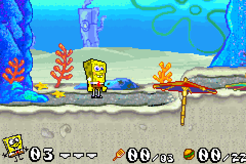
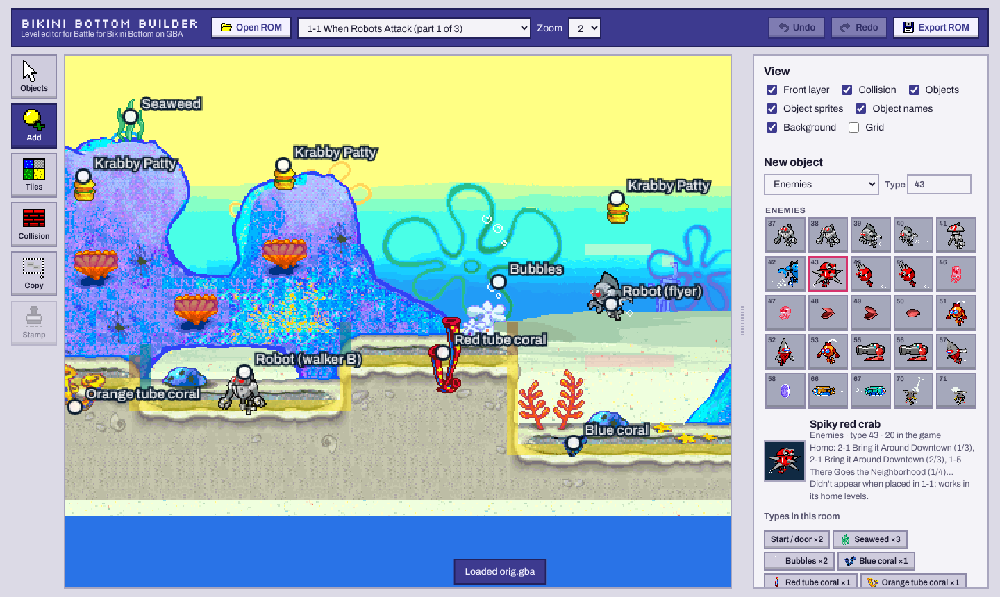
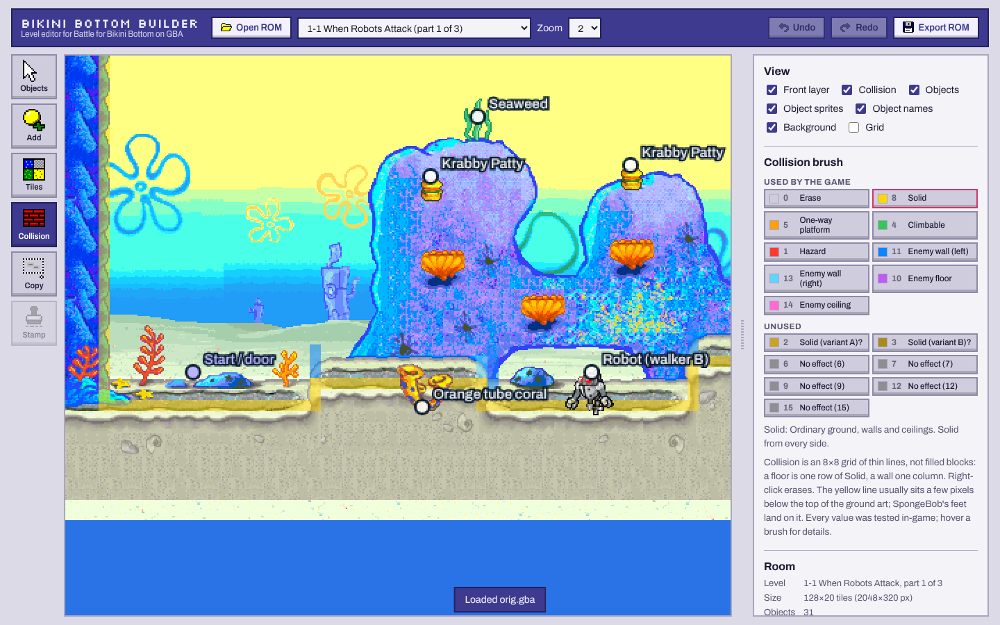
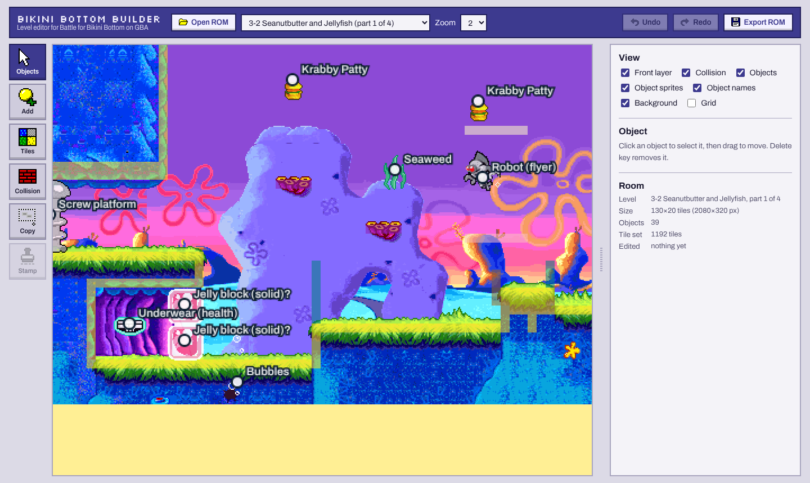
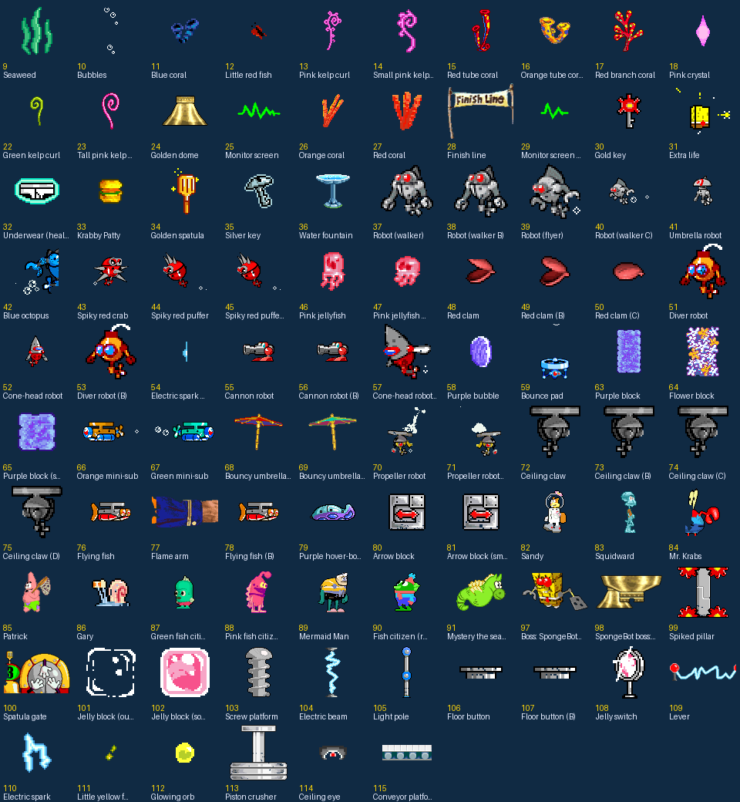

# Bikini Bottom Builder

A level editor for *SpongeBob SquarePants: Battle for Bikini Bottom* on the Game Boy Advance.

## Features

* **Edit any level.** All 112 rooms from the game, named by level and part.
* **Place objects.** Pick from 108 identified objects, including pickups, enemies, characters, platforms and scenery. Each one is shown with its in game sprite.
* **Paint tiles.** Use each room's own tile set, and right click to pick up a tile from the level.
* **Edit collision.** Paint solid ground, one way platforms, ladders, hazards and the invisible walls that keep enemies on their ledges.
* **Copy & stamp.** Copy a platform along with its collision and stamp copies anywhere.
* **Overwrite a room.** Swap any room for a full copy of another room from the game, including its tiles, colours, backgrounds, collision and objects. It keeps its place in the level and its exits still lead to the next part.
* **Backgrounds.** See the parallax skies behind the level while you edit.
* **Undo and redo.** Ctrl+Z, and Ctrl+Shift+Z or Ctrl+Y.
* **Export a playable ROM.** It runs in any GBA emulator.

## Screenshots

## Getting started

1. Download the latest version from the [Releases page](../../releases/latest). Run `BikiniBottomBuilder.exe` on Windows, or open `BikiniBottomBuilder.html` in Chrome or Edge.
2. Click **Choose .gba file** and open your own *Battle for Bikini Bottom (USA)* ROM. No ROM is included.
3. Edit, click **Export ROM**, then play the exported file in an emulator such as [mGBA](https://mgba.io).

*SpongeBob SquarePants* is © Viacom International / Nickelodeon. *Battle for Bikini Bottom* (GBA) is by Vicarious Visions and THQ. This is an unofficial fan project.
